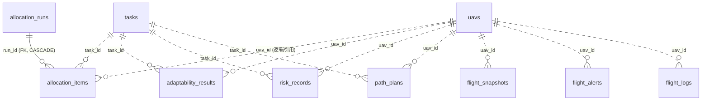

# 数据库表设计 — st_risk 库 10 张表

> 版本：v1.0 | 日期：2026-10-14
> 迁移依据：Alembic head `36f6d2afa024`（initial schema）
> 本文的列与索引清单以真库 `information_schema` / `pg_indexes` 实测为准，与模型、迁移三方一致。
> 面向读者：后端开发者（Python / Node）、需要直接查库做实验分析的人。

本文交代 `st_risk` 库中 10 张表的**定义**（列、类型、约束、索引）与**作用**（谁写、谁读、支撑哪条业务线），
并附 psql 速查与 Node 后端对齐注意点。

## 一、总览

- 数据库：本机 PostgreSQL 18 + **PostGIS 3.6.2**（空间）+ **pgvector**（向量），库名 `st_risk`
- 建表：**DDL 唯一权威是 Alembic 迁移**（`alembic/versions/`），应用层不建表，Node 侧 Drizzle 本轮不参与 DDL
- 模型：`src/db/models/` 下 10 张表全部导出（`models/__init__.py`），迁移 autogenerate 依赖这份清单

```bash
# 建表 / 升级（在 apps/server/python-fastapi-backend 下；未激活 venv 时用 .venv/Scripts/python.exe -m alembic）
alembic upgrade head
# 比对模型与库（当前会报 5 个迁移专属索引 + spatial_ref_sys，属已知预期，见 §六）
alembic check
```

| 表 | 组 | 作用（一行） | 当前写入方 | 主键 / 粒度 |
|---|---|---|---|---|
| `uavs` | A 主数据 | 无人机资源台账 | Python `/uavs` 端点代写（将移交 Node） | `id` TEXT；1 行 = 1 架 |
| `tasks` | A 主数据 | 任务清单 | **无**（等 Node 接库） | `id` TEXT；1 行 = 1 个任务 |
| `allocation_runs` | B 结果 | 一次 `/tasks/allocate` 调用的汇总指标 | Python | UUID；1 行 = 1 次调用 |
| `allocation_items` | B 结果 | 该次调用的 uav→task 配对明细 | Python | int 自增；1 行 = 1 个配对 |
| `adaptability_results` | B 结果 | 任务适配评估结论 | Python | int 自增；1 行 = 1 次评估 |
| `risk_records` | B 结果 | 飞行风险评估结论 | Python | int 自增；1 行 = 1 次评估 |
| `path_plans` | B 结果 | 航线规划产出 | Python | int 自增；1 行 = 1 次规划 |
| `flight_snapshots` | C 监控 | 逐点健康快照（高频追加） | Python | int 自增 |
| `flight_alerts` | C 监控 | 异常告警事件（低频） | Python | int 自增 |
| `flight_logs` | C 轨迹 | 一次「飞行会话」的聚合（**暂无写入方**） | — | `id` TEXT |

B 组是本项目的**实验数据**所在（算法对比分析都查这几张表）；A 组是主数据，C 组是运行时/监控数据。

## 二、通用约定

1. **命名**：表名复数 snake_case；列名与领域模型字段一致（`src/domain/models.py`）。
2. **主键**分三类：TEXT 业务 ID 由调用方提供（`uavs` / `tasks` / `flight_logs`）；结果与监控表用 `int4` 自增；
   `allocation_runs` 用 UUID（服务端生成 uuid4）。
3. **时间戳**：`created_at` / `updated_at` 为 `timestamptz`，数据库端有 `now()` 默认值 ——
   **全库只有这两类时间列有 server default**。`updated_at` 的自动刷新是 SQLAlchemy 的 `onupdate`，
   只在**经 ORM 更新行时**生效；数据库没有触发器，裸 SQL `UPDATE` 不会刷新它。
4. **几何列**：`geometry(POINTZ, 4326)` / `geometry(LINESTRINGZ, 4326)`，三维、单位米（z = 高度）；写入用 EWKT 文本
   （`ST_GeomFromEWKT`）。注：PostGIS 的 `geometry_columns` 视图会把 Z 后缀去掉（显示 `POINT` + `coord_dimension = 3`），属正常现象。
5. **JSONB 列**存放 `list[str]` 或结构化列表（如 `waypoints`、`params`）。
6. **外键全库只有一条**：`allocation_items.run_id → allocation_runs.id`（`ON DELETE CASCADE`）。
   其余 `uav_id` / `task_id` 都是**逻辑引用**（跨服务共享库，不设约束）：删除一架 UAV **不会**级联清理它的结果行。
7. ⚠️ **默认值多在 ORM 层，DDL 里没有**：`status` / `priority` / `is_anomaly` / `anomaly_reasons` /
   `reasons` / `details` / `waypoints` / `unassigned_task_ids` 的默认值（`'idle'`、`'medium'`、`false`、`[]` …）
   定义在 SQLAlchemy 模型里。用 psql 或 Node 侧驱动**直接 INSERT 时必须显式带值**（这些列都是 NOT NULL），数据库不会替你补。

## 三、A 组 — 主数据表（将来 Node 写入、Python 只读）

### 3.1 `uavs` — 无人机资源台账

**作用**：系统里有哪些无人机、各自在哪、能飞多快、能带多少、还剩多少电、当前什么状态。
6 个业务模块的公共输入：任务分配读位置/速度/载荷/电池（算航程与代价），适配评估读载荷与电池，
航线规划读起点位置，监控按 `status` 过滤。

**写入**：本轮由 Python 的 `/uavs` 端点代写（Node 侧尚未接库）；Node 就绪后写权限移交，Python 退化为只读。
**读取**：`GET /api/v1/uavs`（可按 `?status=` 过滤）· `GET /api/v1/uavs/{id}`。

| 列 | 类型 | 空 | 默认 | 说明 |
|---|---|---|---|---|
| `id` | varchar | NO | — | 无人机 ID（调用方提供，如 `"1"`、`"uav-1"`） |
| `position` | geometry(POINTZ, 4326) | NO | — | 当前位置（三维，含高度 z，单位米） |
| `speed` | float8 | NO | — | 最大速度 m/s，参与飞行时间与 deadline 计算 |
| `max_payload` | float8 | NO | — | 最大载荷 kg（CW 容量约束） |
| `battery` | float8 | NO | — | 电池容量 Wh（按 `battery / energy_per_meter` 推导最大航程） |
| `status` | varchar | NO | `'idle'`（ORM） | `idle` \| `assigned` \| `in_flight` \| `returning` \| `maintenance` \| `offline` |
| `created_at` | timestamptz | NO | `now()`（DB） | 注册时间 |
| `updated_at` | timestamptz | NO | `now()`（DB；ORM 更新时刷新） | 最近变更时间 |

**写入触发点**（db 模式）：`POST /api/v1/uavs`（注册）· `PATCH /api/v1/uavs/{id}/status`（改状态）·
`DELETE /api/v1/uavs/{id}`（删除）；仓储另有 `update_position`，无 HTTP 端点（服务内部用）。
**索引**：`uavs_pkey`(id) · `idx_uavs_position` GIST(position)。

### 3.2 `tasks` — 任务清单

**作用**：待执行任务的目标点、优先级、载荷需求、时限与状态。

**写入**：**当前没有任何写入方** —— Python 侧没有建任务的端点（任务分配端点直接用请求体里的任务，不读表）；
表由迁移预建，等 Node 接库后由 Node 写入（Python 届时只读）。

| 列 | 类型 | 空 | 默认 | 说明 |
|---|---|---|---|---|
| `id` | varchar | NO | — | 任务 ID |
| `position` | geometry(POINTZ, 4326) | NO | — | 目标位置 |
| `priority` | varchar | NO | `'medium'`（ORM） | `low` \| `medium` \| `high` \| `urgent`；权重 1 / 1.5 / 2 / 3（仅 hungarian 代价使用） |
| `payload_weight` | float8 | NO | — | 所需载荷 kg |
| `time_limit` | float8 | YES | — | 时间限制（秒），仅 DE 适应度使用 |
| `status` | varchar | NO | `'pending'`（ORM） | 任务状态字符串（Node 侧语义） |
| `created_at` | timestamptz | NO | `now()`（DB） | |
| `updated_at` | timestamptz | NO | `now()`（DB；ORM 更新时刷新） | |

**写入触发点**：无。**读取**：Python 当前不读（无任务仓储）。
**索引**：`tasks_pkey`(id) · `idx_tasks_position` GIST(position)。

两处刻意的对齐决策：`time_limit` 用浮点（Node 侧 Drizzle 计划写 integer，浮点能无损容纳整数、反之会截断）；
`status` 是 Python 侧补齐的列（对齐 Node 已有模型，避免两端继续漂移）。

## 四、B 组 — 算法结果表（Python 写入）

统一机制：四个算法端点在 `db` 模式且 `UAV_PERSIST_RESULTS ≠ off` 时落库（`src/api/v1/endpoints/_persist.py`）；
**写库失败会让请求返回 500**（设计取舍：不静默丢实验数据）。`memory` 模式下这些表不会有新行。

### 4.1 `allocation_runs` + `allocation_items` — 任务分配结果（run + 明细两层）

**作用**：算法对比实验的核心数据。一次 `POST /tasks/allocate` = 一条 run（算法名、参数、输入规模、
分配/未分配数、耗时）；该次调用的每个 uav→task 配对 = 一条 item。按 `algorithm` 分组即可横向比较
四种算法（hungarian / auction / cw / de）的表现；items 可完整回放某次分配方案。

**写入触发点**：`POST /api/v1/tasks/allocate` → `save_run`（同一事务写入 run 与全部 items）。
**读取**：`GET /api/v1/tasks/runs`（摘要列表，支持 `?algorithm=` 与 `?limit=`；`total` 是独立 COUNT，
不受 limit 影响）· `GET /api/v1/tasks/runs/{run_id}`（摘要 + 全部明细）。

`allocation_runs`：

| 列 | 类型 | 空 | 默认 | 说明 |
|---|---|---|---|---|
| `id` | uuid | NO | 服务端 uuid4 | run 标识 |
| `algorithm` | varchar | NO | — | `hungarian` \| `auction` \| `cw` \| `de` |
| `params` | jsonb | YES | — | 本次调用的算法参数原文（可空） |
| `uav_count` / `task_count` | int4 | NO | — | 输入规模 |
| `assigned_count` | int4 | NO | — | 分配成功的配对数（= 该 run 的 items 行数） |
| `unassigned_count` | int4 | NO | — | 未分配任务数 |
| `unassigned_task_ids` | jsonb | NO | `[]`（ORM） | 未分配任务 ID 列表 |
| `duration_ms` | float8 | YES | — | 求解耗时（端点侧计时） |
| `created_at` | timestamptz | NO | `now()`（DB） | |

`allocation_items`：

| 列 | 类型 | 空 | 默认 | 说明 |
|---|---|---|---|---|
| `id` | int4 自增 | NO | — | 明细行号 |
| `run_id` | uuid | NO | — | **外键** → `allocation_runs.id`，`ON DELETE CASCADE` |
| `uav_id` / `task_id` | varchar | NO | — | 逻辑引用 `uavs` / `tasks` |
| `estimated_cost` | float8 | NO | — | 预估代价，**口径随算法不同，不可跨算法比较**（见 [docs/api/task-allocation.md](api/task-allocation.md) §六） |

**索引**：runs → pkey · `idx_allocation_runs_algorithm(algorithm, created_at)`；
items → pkey · `ix_allocation_items_run_id` · `ix_allocation_items_task_id` · `ix_allocation_items_uav_id`。

### 4.3 `adaptability_results` — 任务适配评估结果

**作用**：一次 `/adaptability/evaluate`（或 `/batch`）的结论：某 UAV 能否执行某任务、
四项检查（载荷 / 电量 / 航程 / 时限）各自是否通过、总分与理由列表。

**写入触发点**：`POST /api/v1/adaptability/evaluate` 与 `POST /api/v1/adaptability/batch` → `save_many`（批量一次写入）。
**读取**：无 HTTP 读端点；仓储有 `find_by_uav`，实验分析用 psql。

| 列 | 类型 | 空 | 默认 | 说明 |
|---|---|---|---|---|
| `id` | int4 自增 | NO | — | |
| `uav_id` / `task_id` | varchar | NO | — | 逻辑引用 |
| `capable` | bool | NO | — | 综合结论（四项检查是否全过） |
| `payload_ok` / `battery_ok` / `range_ok` / `time_ok` | bool | NO | — | 四项单项检查 |
| `score` | float8 | NO | — | 适配评分 |
| `reasons` | jsonb | NO | `[]`（ORM） | 理由列表 |
| `created_at` | timestamptz | NO | `now()`（DB） | |

**索引**：pkey · `ix_adaptability_results_uav_id` · `ix_adaptability_results_task_id`。

### 4.4 `risk_records` — 飞行风险评估记录

**作用**：一次 `/risk/assess` 的结论：碰撞 / 气象 / 电量三类风险分、综合分与风险等级；
`weather_factor` 与 `details` 保留计算细节，便于复算与论文引用。

**写入触发点**：`POST /api/v1/risk/assess` → `save`。**读取**：无 HTTP 读端点（`find_by_uav`）。

| 列 | 类型 | 空 | 默认 | 说明 |
|---|---|---|---|---|
| `id` | int4 自增 | NO | — | |
| `uav_id` / `task_id` | varchar | NO | — | 逻辑引用 |
| `risk_level` | varchar | NO | — | `low` \| `medium` \| `high` \| `critical` |
| `collision_risk` / `weather_risk` / `battery_risk` | float8 | NO | — | 三类风险分（0–1） |
| `overall_score` | float8 | NO | — | 综合分 |
| `weather_factor` | float8 | YES | — | 气象因子（可空） |
| `details` | jsonb | NO | `[]`（ORM） | 明细 |
| `created_at` | timestamptz | NO | `now()`（DB） | |

**索引**：pkey · `idx_risk_records_uav(uav_id, created_at)` · `ix_risk_records_uav_id` · `ix_risk_records_task_id`。

### 4.5 `path_plans` — 航线规划结果

**作用**：一次 `/paths/plan` 的产出：航点序列（含每点到达时间）、总距离、预计耗时、算法名与求解耗时。

**写入触发点**：`POST /api/v1/paths/plan` → `save`。**读取**：无 HTTP 读端点（`find_by_uav`）。

| 列 | 类型 | 空 | 默认 | 说明 |
|---|---|---|---|---|
| `id` | int4 自增 | NO | — | |
| `uav_id` / `task_id` | varchar | NO | — | 逻辑引用 |
| `algorithm` | varchar | NO | — | `astar` \| `rrt` |
| `waypoints` | jsonb | NO | `[]`（ORM） | 航点列表（含到达时间）。**刻意用 JSONB 而非 PostGIS 线几何** —— 航点带时间维度，转几何会丢；将来需要空间查询再补由它派生的 `LINESTRINGZ` 列 |
| `total_distance` | float8 | NO | — | 总航程（米） |
| `estimated_time` | float8 | NO | — | 预计耗时（秒） |
| `duration_ms` | float8 | YES | — | 求解耗时（端点侧计时，可空） |
| `created_at` | timestamptz | NO | `now()`（DB） | |

**索引**：pkey · `ix_path_plans_uav_id` · `ix_path_plans_task_id`。

## 五、C 组 — 运行时 / 监控表（Python 写入）

### 5.1 `flight_snapshots` — 逐点健康快照

**作用**：每次 `POST /monitoring/snapshot` 追加一行：仿真时刻、位置、电量、速度、航向，
以及服务端判定的异常标记与原因。高频追加；`GET /monitoring/track/{uav_id}` 取最近 N 点回放轨迹，
`GET /monitoring/overview` 用 `distinct uav_id` 统计有数据的无人机。

**写入触发点**：`POST /api/v1/monitoring/snapshot` → `record_snapshot` →
**先做异常判定、再落库**（这一顺序由回归测试锁定：先落库后判定会让 `is_anomaly` 恒为 false）。

| 列 | 类型 | 空 | 默认 | 说明 |
|---|---|---|---|---|
| `id` | int4 自增 | NO | — | |
| `uav_id` | varchar | NO | — | 逻辑引用 |
| `ts` | float8 | NO | — | **仿真时间戳（秒）**，不是墙钟时间；刻意不用 timestamptz，否则丢仿真语义 |
| `position` | geometry(POINTZ, 4326) | NO | — | 该时刻位置 |
| `battery_remaining` | float8 | NO | — | 剩余电量 |
| `speed` / `heading` | float8 | NO | — | 速度 (m/s) / 航向（度） |
| `is_anomaly` | bool | NO | `false`（ORM） | 是否异常（服务层判定结果） |
| `anomaly_reasons` | jsonb | NO | `[]`（ORM） | 异常原因列表 |
| `created_at` | timestamptz | NO | `now()`（DB） | **墙钟落库时间**（与仿真钟 `ts` 是两回事） |

**索引**：pkey · `idx_flight_snapshots_uav(uav_id, ts)`（取轨迹主用）· `ix_flight_snapshots_uav_id` ·
`idx_flight_snapshots_position` GIST(position)。

### 5.2 `flight_alerts` — 异常告警事件

**作用**：与快照分表存放（写入频率、查询方式、保留策略都不同）。快照被判为异常时，**每个原因写一行告警**。

**写入触发点**：同快照端点。**读取**：`GET /api/v1/monitoring/alerts/{uav_id}`。
**删除**：`DELETE /api/v1/monitoring/alerts/{uav_id}` —— 全库唯一会整批删行的路径（清空该机告警）。

| 列 | 类型 | 空 | 默认 | 说明 |
|---|---|---|---|---|
| `id` | int4 自增 | NO | — | |
| `uav_id` | varchar | NO | — | 逻辑引用 |
| `message` | varchar | NO | — | 告警文本（一条原因一条） |
| `created_at` | timestamptz | NO | `now()`（DB） | |

**索引**：pkey · `idx_flight_alerts_uav(uav_id, created_at)` · `ix_flight_alerts_uav_id`。

### 5.3 `flight_logs` — 飞行会话轨迹（暂无写入方）

**作用**：为「一次飞行会话」这一聚合概念预留：整条 3D 轨迹线 + 128 维特征向量（为轨迹相似度检索做准备）。
现有代码只有逐点快照（`flight_snapshots`），还不存在「会话」边界，所以**表和列先建好、暂不写入**。

| 列 | 类型 | 空 | 默认 | 说明 |
|---|---|---|---|---|
| `id` | varchar | NO | — | 会话 ID（调用方提供） |
| `uav_id` | varchar | NO | — | 逻辑引用 |
| `track` | geometry(LINESTRINGZ, 4326) | YES | — | 整条三维轨迹线 |
| `embedding` | vector(128) | YES | — | pgvector 特征向量（轨迹相似度检索用） |
| `start_time` / `end_time` | timestamp（**无时区**） | YES | — | 会话起止 |
| `total_distance` | float8 | YES | — | 总航程 |

**索引**：pkey · `idx_flight_logs_track` GIST(track) · `idx_flight_logs_embedding` HNSW(`vector_l2_ops`) ·
`ix_flight_logs_uav_id`。

⚠️ 注意两处与设计文档的实况差异：设计文档写 `start_time` / `end_time` 为 `TIMESTAMPTZ`，
实建为**不带时区**的 `timestamp`（模型与迁移一致）。若将来需要时区语义，需单独一条迁移改列。

## 六、索引总览（实测 31 个）

| 类别 | 数量 | 清单 |
|---|---|---|
| 主键 | 10 | 每表 `*_pkey` |
| **GIST**（空间） | 4 | `idx_uavs_position` · `idx_tasks_position` · `idx_flight_snapshots_position` · `idx_flight_logs_track` |
| **HNSW**（向量） | 1 | `idx_flight_logs_embedding`（`vector_l2_ops`） |
| 复合 B-tree | 4 | `idx_allocation_runs_algorithm(algorithm, created_at)` · `idx_risk_records_uav(uav_id, created_at)` · `idx_flight_snapshots_uav(uav_id, ts)` · `idx_flight_alerts_uav(uav_id, created_at)` |
| 单列 B-tree | 12 | 各模型的 `index=True` 列（`ix_*`：各结果表的 `uav_id` / `task_id`、`allocation_items.run_id`、`flight_logs.uav_id` 等） |

三点维护须知：

1. **GIST 索引由 geoalchemy2 自动创建**（`Geometry` 列默认 `spatial_index=True`，CREATE TABLE 时附带）；
   迁移里**不要**再显式 `op.create_index`，否则同名冲突（`DuplicateTableError`）。
2. 复合索引 `(uav_id, created_at)` / `(uav_id, ts)` 在查询前缀上覆盖了同列单列索引（冗余但无害，保留）。
3. ⚠️ **5 个「迁移专属」索引**（上表 4 个复合 + 1 个 HNSW）只存在于迁移文件、不在模型元数据里，
   所以 `alembic check` 会稳定报这 5 条 + `spatial_ref_sys`，属**已知预期**。
   但下次 `alembic revision --autogenerate` 会因此生成 `drop_index` —— **动 schema 前先把这 5 个索引声明进模型的
   `__table_args__`**。

## 七、表间关系



- 实线 = 数据库外键（仅 `allocation_items.run_id` 一条，删 run 级联删明细）。
- 虚线 = 逻辑引用（`uav_id` / `task_id` 指向 `uavs` / `tasks`，无约束）：
  这是**跨后端共享同一个库**的取舍 —— Node 与 Python 各写各的表，库层不做跨模块强耦合；
  代价是删除 UAV/任务时结果表不会被清理，需要应用层负责。

## 八、psql 速查

```bash
# 在 apps/server/python-fastapi-backend 下执行；密码从配置读取注入，不落盘、不回显
export PGPASSWORD=$(.venv/Scripts/python.exe -c "from urllib.parse import urlparse; from src.utils.config import get_settings; print(urlparse(get_settings().database_url).password or '')")
psql -U postgres -h localhost -d st_risk
```

```sql
-- 总览
\dt
SELECT (SELECT count(*) FROM uavs) AS uavs,
       (SELECT count(*) FROM allocation_runs) AS runs,
       (SELECT count(*) FROM flight_snapshots) AS snapshots;

-- 算法横向对比（对比实验主查询）
SELECT algorithm, count(*) AS n_runs, avg(assigned_count)::numeric(6,1) AS avg_assigned,
       avg(duration_ms)::numeric(8,1) AS avg_ms
FROM allocation_runs GROUP BY algorithm ORDER BY algorithm;

-- 最近几次分配的摘要
SELECT id, algorithm, uav_count, task_count, assigned_count, unassigned_count, duration_ms, created_at
FROM allocation_runs ORDER BY created_at DESC LIMIT 10;

-- 某次分配的明细（把 <run_id> 换成上面的 id）
SELECT i.uav_id, i.task_id, i.estimated_cost
FROM allocation_items i WHERE i.run_id = '<run_id>' ORDER BY i.id;

-- 某机最近快照与告警
SELECT ts, ST_AsText(position) AS pos, battery_remaining, is_anomaly, anomaly_reasons
FROM flight_snapshots WHERE uav_id = '1' ORDER BY ts DESC LIMIT 20;
SELECT id, message, created_at FROM flight_alerts WHERE uav_id = '1' ORDER BY id;
```

> 集成测试会往结果表/监控表写入数据且不自动清理；做正式实验前想清空测试数据，
> 用 `TRUNCATE allocation_runs CASCADE, allocation_items, adaptability_results, risk_records, path_plans, flight_snapshots, flight_alerts;`
> （`CASCADE` 为连带清 `allocation_items`；`uavs` / `tasks` 按需另行处理）。

## 九、与 Node 后端对齐的事项

1. **写权移交**：`uavs` / `tasks` 的写入方是将来接库的 Node 后端；Node 就绪后 Python 的 `/uavs` 端点退化为只读。
   本轮 Python 代写只是过渡。
2. **类型口径**：`time_limit` 用浮点（Node 侧 Drizzle 计划 integer，需对齐）；字符串列是 `varchar`（无长度限制，
   SQLAlchemy `String` 默认）；数值列统一 `float8`（不是 REAL）。
3. **server_default 缺位**（见 §二.7）：`status` / `priority` 等默认值只在 ORM 层。
   如果 Node 期望「不传状态就落 `'pending'`」，需要新迁移补 `server_default` —— 这是 Node 对齐的前置项。
4. **DDL 权威**：建表/改表一律走 Alembic；Node 侧 Drizzle 只做映射与读写，不参与 DDL。
5. `flight_logs.start_time` / `end_time` 无时区（§5.3）；若 Node 或前端需要时区语义，一并改。

## 十、相关文档

| 文档 | 说明 |
|---|---|
| [README](../README.md) | 端点速查、ER 图、配置项（`UAV_REPOSITORY_BACKEND` / `UAV_PERSIST_RESULTS`） |
| [持久化设计文档](superpowers/specs/2026-10-13-python-db-persistence-design.md) | 表结构决策依据（表归属、粒度、JSONB 取舍） |
| [持久化实现计划](superpowers/plans/2026-10-13-python-db-persistence.md) | 14 个任务的实施步骤与验收记录 |
| [任务分配接口文档](api/task-allocation.md) | `estimated_cost` 口径对照、算法参数 |
