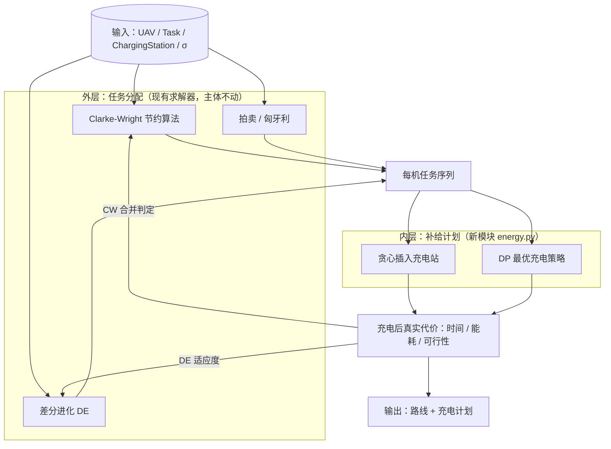
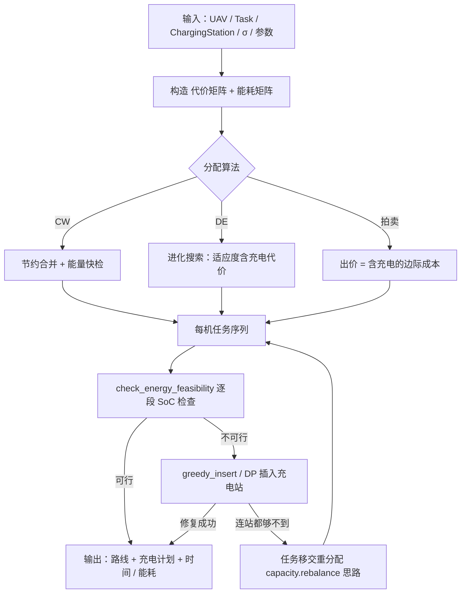

# 无人机补给（充电）分配设计

> 本文档是充电站引入后的任务分配设计稿，与现有实现（`apps/server/python-fastapi-backend` 中的 Clarke-Wright 与差分进化求解器）对接。
> 回答四个问题：**谁做哪些任务、以什么顺序做、途中何时去哪个站充电、充多少**，使总完成时间最小。

---

## 1. 问题定义

### 1.1 一句话问题

给定 `N` 架无人机、`M` 个任务、`K` 个充电站，求一组**带充电计划的飞行路线**（每机一条，覆盖全部任务），使得：

- 每架无人机在任意时刻剩余电量不低于安全余量 `σ`；
- 每机总载荷不超过 `max_payload`，任务满足 deadline（若有时）；
- **总完成时间（makespan）最小**（备选目标：总飞行时间、总能耗）。

### 1.2 为什么充电站改变了问题性质

| | 现状（无充电站） | 引入充电站后 |
|---|---|---|
| 能量处理方式 | 一次性预算：`总航程 ≤ max_range`（`_common.derive_uav_ranges`：`battery / energy_per_meter`） | 逐段电量状态（SoC）跟踪，中途可"续命" |
| 不可行的含义 | 该路线直接淘汰 → 换机 / 删任务 | 仍然可行，但代价 = 绕行 + 充电时间 |
| 求解耦合 | 分配 → 排序 → 查总预算，单向流水 | 分配与补给互相依赖：路线影响充电计划，充电代价反过来影响分配优劣 |

一句话总结：问题从**带容量约束的任务分配**升级为**带能量约束的车辆路径问题（E-VRP）变体**——充电站把"可行/不可行"的二元判断变成了"可行但更慢"的连续代价，分配层必须感知充电代价，否则会把最优解排到次优甚至淘汰。

### 1.3 输入 / 输出

**输入**

| 符号 | 含义 | 现有代码对应 |
|---|---|---|
| UAV | 位置、速度、电池容量（Wh）、最大载荷 | `domain/models.py: UAV` |
| Task | 位置、优先级、载荷、deadline（可选） | `domain/models.py: Task` |
| ChargingStation | 位置、充电功率（W）、桩位数（可选） | **新增**，见 §6.1 |
| energy_per_meter | 单位能耗率，默认 0.1 Wh/m | `_common.py / DEConfig` |
| σ | 安全余量（Wh），电量不允许低于该值 | **新增参数** |

**输出**：每架无人机的完整路线（任务序列 + 充电站访问点 + 每次充电量）、预计总时间 / 总能耗、可行性报告。

### 1.4 与现有实现的差距（现状盘点）

| 现有代码 | 现状 | 需要补的能力 |
|---|---|---|
| `_common.build_cost_matrix` | 只有 UAV + 任务节点，距离 × 优先级权重 | 加入充电站节点；另建**物理距离矩阵**供能耗计算（优先级权重不能带进能耗） |
| `_common.derive_uav_ranges` | 电池 → 总航程上限 | 保留作快速剪枝，但不再是充要条件 |
| CW `capacity.feasible` | 总航程 ≤ max_range 且总载荷 ≤ max_payload | 合并判定接入能量快检；构造后增加能量修复步骤 |
| DE `fitness.evaluate_constrained` | 航程 / deadline / 负载均衡 3 个约束（Zhao et al. 2012, Eq. 23） | 增加能量约束项，或把内层充电代价直接作为适应度 |
| `domain/models.py` | 无充电站模型 | 新增 `ChargingStation` |

结论：改动集中在 **1 个新模型 + 1 个新模块（energy）+ 2 个求解器的嵌入点**，分配求解器主体不动。

---

## 2. 数学建模

### 2.1 符号

| 符号 | 含义 |
|---|---|
| `U` | 无人机集合，`k ∈ U` |
| `T` | 任务集合 |
| `S` | 充电站集合，站 `i` 的充电功率 `P_i`（W） |
| `o_k, e_k` | 无人机 `k` 的起点（当前位置）/ 终点（基地或就近机巢） |
| `c_ij` | 弧 `(i,j)` 的物理能耗（Wh）= 距离 × energy_per_meter |
| `t_ij` | 弧 `(i,j)` 的飞行时间（s） |
| `B_k` | 无人机 `k` 电池容量（Wh） |
| `σ` | 安全余量（Wh） |
| `d_j` | 任务 `j` 的 deadline（s，可选） |

### 2.2 决策变量

- `x_kij ∈ {0,1}`：无人机 `k` 是否飞弧 `(i,j)`；
- `e_ki ≥ 0`：无人机 `k` 到达节点 `i` 时（充电前）的剩余电量；
- `q_ki ≥ 0`：无人机 `k` 在节点 `i` 的充电量（`i ∉ S` 时恒为 0）；
- `a_ki ≥ 0`：无人机 `k` 到达节点 `i` 的时刻。

### 2.3 约束与目标

**目标**：`min T`，满足 `T ≥ a_k,e_k`（makespan 最小；备选：总飞行时间、总能耗）。

**约束**：

```
(1) 任务覆盖：     Σ_k Σ_{i≠j} x_kij = 1                                  ∀ j ∈ T
(2) 流守恒：       Σ_i x_kij = Σ_i x_kji，Σ_j x_k,o_k,j = 1，Σ_i x_k,i,e_k = 1
(3) 电量递推：     e_kj ≤ e_ki + q_ki − c_ij + B_k·(1 − x_kij)            ∀ k, (i,j)
(4) 充电限制：     q_ki ≤ B_k·[i ∈ S]；e_ki + q_ki ≤ B_k（充电后不超上限）
(5) 安全余量：     e_kj ≥ σ                                                ∀ j ∈ T
(6) 时间递推：     a_kj ≥ a_ki + t_ij + q_ki / P_i − M·(1 − x_kij)
(7) 任务时限：     a_kj ≤ d_j
(8) 变量域：       x ∈ {0,1}，e、q、a ≥ 0
```

约束 (3) 是核心：电量沿路径逐段衰减，充电量 `q_ki` 只在站上被允许注入。注意约束 (4) 允许**部分充电**（`q_ki` 连续），这正是"充多少"的决策空间。

### 2.4 复杂度与分解动机

- 去掉充电站（`S = ∅`、`q = 0`）后问题退化为"分配 + 排序"，本身含 TSP，**NP-hard**；
- 但**给定任务序列后，最优充电计划是伪多项式可解的**：把电量离散化为 `Δ` 一档，状态 `(节点, 电量)` 共 `O((|T|+|S|)·⌈B/Δ⌉)` 个，可用动态规划精确求解（§5.5）；
- 因此采用"外层分配 + 内层充电"的分层结构：外层沿用已实现的 CW / DE / 拍卖，内层用 DP（离线精确）或贪心（在线快速）求解充电计划。全问题的精确算法（branch-and-price）仅适用于小规模，作为验证基线。

---

## 3. 总体思路：外层分配 + 内层充电

核心思想：**分配求解器负责"谁做什么、什么顺序"，新模块 `energy` 负责"给定序列，怎么充电"**。内层返回真实代价（时间、能耗）回代入外层，形成闭环：



选择分层的三个理由：

1. **组合爆炸**：分配 × 排序 × 充电联合搜索空间过大，分层后外层搜索空间不变（沿用现有编码），内层子问题有精确算法；
2. **复用现有资产**：CW 的节约合并与容量修复、DE 的整数编码与约束感知适应度都已实现并测试，只需在判定处接入内层；
3. **策略可插拔**：内层贪心 / DP / 阈值策略按场景切换，不影响外层接口。

---

## 4. 实际例子（完整演算）

### 4.0 场景设定

1 架无人机（电池 `B = 100 Wh`，速度 `v = 10 m/s`），任务序列已由外层给出：`D → T1 → T2 → T3 → E`（D 为起点，E 为终点），充电站 `C`（功率 `P = 700 W`）。能耗率取代码默认值 `0.1 Wh/m`，安全余量 `σ = 10 Wh`。

> 为聚焦能量逻辑，本例直接以 Wh 给出各段消耗（等价于 0.1 Wh/m 下的距离 × 10）。本参数下有个方便的性质：**1 Wh 的飞行 ≈ 1 s**（10 m ÷ 10 m/s），而 **1 Wh 的充电 ≈ 5.14 s**（3600 ÷ 700）——充电的单位能量时间成本是飞行的 5 倍。

各段能耗（Wh，对称）：

| 弧 | 能耗 | 弧 | 能耗 |
|---|---|---|---|
| D→T1 | 40 | T1→C | 30 |
| T1→T2 | 60 | C→T2 | 35 |
| T2→T3 | 30 | T2→C | 40 |
| T3→E | 25 | C→T3 | 15 |

### 4.1 步骤 1：无充电可行性检查（失败）

从满电出发逐段扣减：

| 时刻 | 节点 | 剩余电量 | 下一段需求 | 判定 |
|---|---|---|---|---|
| 出发 | D | 100 | 40 | ✓ |
| 到达 | T1 | 60 | 60 | ✓（但到 T2 后剩 0） |
| 到达 | T2 | **0** | 30 | **✗ 卡死** |

直飞总需求 `40+60+30+25 = 155 Wh > 100 Wh`，无充电不可行。按现状代码的逻辑（总航程 ≤ max_range），这条路线会被直接淘汰。

### 4.2 步骤 2：贪心插入（阈值触发，σ = 10）

规则：**若到达下一节点后剩余电量 < σ，先在绕行代价最小的充电站充电**。

- 在 T1：飞 T2 后剩 `60 − 60 = 0 < 10` → 触发；
- 唯一站 C 的绕行代价 `T1→C→T2 = 30 + 35 = 65`，仅比直飞 `60` 多 **5 Wh**；
- 到 C 后电量 `60 − 30 = 30 ≥ σ`，可达 → 充满至 100（充 70）；
- 继续：C→T2（剩 65）→ T3（剩 35）→ E（剩 **10 = σ**）✓。

**修复后路线**：`D → T1 → C(充70) → T2 → T3 → E`

| 指标 | 数值 |
|---|---|
| 飞行能耗 / 距离 / 时间 | 160 Wh / 1600 m / 160 s ≈ 2.7 min |
| 充电量 / 充电时间 | 70 Wh / 6 min |
| 总时间 | **≈ 8.67 min**（520 s） |
| 结束电量 | 10 Wh（= σ） |

关键观察：**绕行只多花 5 s，充电却花 360 s**——补给代价中充电时间占绝对主导，站的位置选择首先要减少充电次数与充电量，绕行是小头。

### 4.3 步骤 3：DP 精确求解

电量按 `Δ = 10 Wh` 离散化为 `{0, 10, …, 100}` 共 11 档，状态空间 `6 节点 × 11 档 = 66` 个。状态 `(节点, 剩余电量)`，转移有两类：

1. **直飞**：`(i, e) → (j, e − c_ij)`，要求到达后电量 `≥ σ`，代价 `t_ij`；
2. **先绕站再充电**：`(i, e) → (C, e − c_iC)`（可达性同上）→ 充至任意档 `e' ∈ [e − c_iC, B]`，代价 `t_iC + (e' − (e − c_iC)) / P`。

最优路径上的状态序列：

| 状态 | 累计时间 | 转移 |
|---|---|---|
| (D, 100) | 0 | 直飞 T1，耗 40 |
| (T1, 60) | 40 s | 绕行 C，耗 30 |
| (C, 30) | 70 s | **充电至 100**，+360 s |
| (C, 100) | 430 s | 直飞 T2，耗 35 |
| (T2, 65) | 465 s | 直飞 T3，耗 30 |
| (T3, 35) | 495 s | 直飞 E，耗 25 |
| (E, 10) | **520 s** | 结束，余量 10 = σ ✓ |

DP 同时淘汰了两类次优方案：

- **充到 90（充 60）**：总时间 468.6 s 更短，但结束电量 0 < σ，违反安全余量 → 不可行；
- **先在 C 充电再出发**（D→C 绕行）：D→C→T1 = 80 比直飞 40 多 40 Wh，纯绕行无收益 → 被支配。

本例 DP 结果与贪心一致（只有一个站时两者等价），但**多站、部分充电、绕行代价差异大时，DP 能给出贪心得不到的最优"充多少"决策**。

### 4.4 步骤 4：充多少的取舍

到 C 时剩 30，剩余航程 `C→T2→T3→E = 35+30+25 = 90 Wh`，因此：

- 充电量下限 = `90 + σ − 30 = 70` → 与充满相同（本例"带余量最优" = 充满）；
- 若忽略 σ，充电量下限 = 60（结束电量恰为 0）。

| 方案 | 充电量 | 充电时间 | 总时间 | 结束电量 | 评价 |
|---|---|---|---|---|---|
| 充到刚好（无余量） | 60 Wh | 5.14 min | 7.81 min | 0 | 最快，但风 / 绕障偏差即坠机 |
| 充满（带余量） | 70 Wh | 6 min | 8.67 min | 10 | **推荐**，余量覆盖模型误差 |
| 不充 | — | — | — | — | 不可行 |

一般结论：**充电量 = 剩余航程 + σ − 到站电量**，落在 `[下限, B]` 区间内；DP 在这个区间上选时间最优档。σ 本质上是"用充电时间买安全"，其标定见 §7.1。

### 4.5 步骤 5：回到分配层

本例路线的代价构成：裸飞行 160 s vs 真实总时间 520 s，**充电使代价放大 3.4 倍**。含义：

- 若分配算法按裸飞行距离排序，会系统性低估需要充电的路线，甚至把"总航程 155 Wh 超预算"的好方案误杀（本例恰恰证明了它是可行且高效的）；
- 因此外层求算器的判定必须使用**充电后真实代价**：CW 在合并判定时调用内层，DE 在适应度中计入充电时间（§6.4 / §6.5）。

---

## 5. 具体策略（何时充、去哪充、充多少）

以下策略都是内层模块的可选实现，输入为"任务序列 + 能耗矩阵"，输出为"含充电计划的路线"。

### 5.1 策略 A：阈值触发 + 最近站（贪心修复）

- **触发**：若到达下一节点后电量 `< σ`，插入充电站；
- **选站**：绕行代价 `c(i,s) + c(s,j) − c(i,j)` 最小的站（次级标准：功率大的站）；
- **充电量**：充满（或充到"剩余航程 + σ"）。

复杂度 `O(L·K)`（L = 路线段数，K = 站数），毫秒级。**适用**：在线重规划、CW 构造期快检、v1 首版实现。缺点：局部决策，多站场景可能多充、多绕。

### 5.2 策略 B：恰好补能（刚好够）

充电量 = 剩余航程 + σ − 到站电量（§4.4 的公式）。充电时间最短，但每段都要重算，且对能耗模型误差零容忍——σ 必须留够，或与风险模块联动（§7.1）。**适用**：离线批量方案、对 makespan 极度敏感的场景。

### 5.3 策略 C：充满

实现最简单，充电次数可能更少（单次续航更长），但单次充电时间长；对未来任务动态插入的鲁棒性最好（余量即缓冲）。**适用**：任务动态性强、站少功率高的场景。

### 5.4 策略 D：机会充电

电量充足时，若顺路绕行代价低于阈值（如剩余航程的 5%）且站空闲，也顺带补能。**适用**：站密集、充电快的场景；能显著减少后续的强制充电次数。

### 5.5 策略 E：DP 最优充电（内层精确）

见 §4.3。给定序列的最优解，伪多项式复杂度；状态数随电量离散档数线性增长，`Δ` 取 `B/10 ~ B/20` 时精度足够。**适用**：离线最终方案、DE 内层最优法（§6.5 v2）、作为其他策略的基准。

### 5.6 策略对比

| 策略 | 充电量决策 | 复杂度 | 最优性 | 本例结果 | 适用场景 |
|---|---|---|---|---|---|
| A 阈值+最近站 | 充满 | O(L·K) | 局部 | 8.67 min | 在线 / v1 |
| B 恰好补能 | 公式精确值 | O(L·K) | 局部 | 7.81 min（零余量，违反 σ） | 离线极限压缩 |
| C 充满 | 充满 | O(1) | — | 8.67 min | 动态任务 |
| D 机会充电 | 阈值判断 | O(L·K) | — | 本例无机会站 | 站密集 |
| E DP 最优 | 全局最优档 | 伪多项式 | **该序列全局最优** | 8.67 min（带 σ 最优） | 离线 / 基准 |

> 本例中 A、C、E 结果相同（单站 + 带余量时充满即最优），但多站或功率差异大的场景下 E 严格占优。

---

## 6. 实现流程（落地到现有代码）

分 3 步：**模型与矩阵扩展 → 新增 energy 模块 → 嵌入 CW 与 DE**。文件路径均为 `apps/server/python-fastapi-backend/src/` 下的相对路径。

### 6.1 数据模型：`domain/models.py`

```python
class ChargingStation(BaseModel):
    """充电站"""
    id: str
    position: Position
    power: float = Field(gt=0, description="充电功率 (W)")
    slots: int = Field(default=1, ge=1, description="同时可服务无人机数（v1 恒为 1，排队见 §7.3）")
```

`UAV` 可增加可选字段 `energy_per_meter: float | None = None`（缺省用全局默认 0.1）。

### 6.2 矩阵扩展：`algorithms/task_allocation/_common.py`

现有 `build_cost_matrix` 索引约定：`0..N_uav-1` 为 UAV，`N_uav..N_uav+N_task-1` 为任务。扩展后：

```
0 .. N_uav-1                      → UAV
N_uav .. N_uav+N_task-1           → 任务（× 优先级权重，沿用现状）
N_uav+N_task .. +N_s-1            → 充电站（不乘优先级权重）
```

**新增两个矩阵**（关键：现有代价矩阵带优先级权重，不能直接当能耗用）：

```python
def build_distance_matrix(uavs, tasks, stations) -> np.ndarray:
    """纯物理距离矩阵（无优先级权重），供能耗计算"""
def build_energy_matrix(..., energy_per_meter: float) -> np.ndarray:
    """能耗矩阵 (Wh) = 距离 × energy_per_meter"""
```

### 6.3 新模块：`algorithms/task_allocation/energy.py`

```python
def check_energy_feasibility(seq, e_matrix, B, sigma) -> tuple[bool, list[float]]:
    """逐段 SoC 跟踪：返回 (可行?, 各节点到达电量)。对应 §4.1"""

def greedy_insert_stations(seq, e_matrix, stations, B, sigma):
    """策略 A：返回 (扩展序列[任务/站交替], 各站充电量, 总时间)。对应 §4.2"""

def optimal_charging_dp(seq, e_matrix, stations, B, sigma, delta):
    """策略 E：电量离散化 DP，返回最优充电计划。对应 §4.3"""
```

贪心插入伪代码：

```python
def greedy_insert(seq, B, sigma):
    e = B
    out, charges = [], []
    for prev, nxt in zip(seq, seq[1:]):
        if e - c(prev, nxt) < sigma:          # 触发：到下一节点后余量不足
            s = argmin_{s∈S} c(prev, s) + c(s, nxt)   # 绕行最小的站
            if e - c(prev, s) < sigma:
                return FAIL                    # 连站都够不到 → 交给重分配（§6.4）
            out.append(s); charges.append((s, B - (e - c(prev, s))))
            e = B                              # 到站充满（策略 A；B/E 策略改此行为）
        e -= c(prev, nxt)
        out.append(nxt)
    return out, charges
```

DP 伪代码（策略 E）：

```python
def dp_charging(seq, stations, B, sigma, delta):
    levels = range(0, B + 1, delta)
    dist = {(node, e): inf};  dist[(start, B)] = 0
    for node in seq_nodes:                    # 按序列顺序 + 站展开
        for e in levels:
            # 转移 1：直飞下一节点（到达后 ≥ sigma）
            for nxt in next_tasks(node):
                if e - c(node, nxt) >= sigma:
                    relax((nxt, e - c(node, nxt)), dist + t(node, nxt))
            # 转移 2：绕站 → 充电至任意档
            for s in stations:
                if e - c(node, s) >= sigma:
                    for e2 in levels:
                        if e2 >= e - c(node, s):
                            relax((s, e2), dist + t(node, s) + (e2 - (e - c(node, s))) / P_s)
    return backtrace(min over (end, e ≥ sigma))
```

### 6.4 CW 集成：`clarke_wright/capacity.py` 与 `solver.py`

两段式，保持贪心构造的速度：

1. **构造期快检**（改 `_feasible` 的调用处，不改合并逻辑）：合并判定时先跑 `check_energy_feasibility`（不插入站，只判"直飞是否可行"）；不可行但**加入最近站绕行后可行**的合并仍放行（否则好解被误杀），代价用含充电的估算。注意：引入充电后，"总航程 ≤ max_range" 只是充分条件，不再是必要条件，保留它仅作快速剪枝。
2. **构造后修复**（`solve()` 末尾，`_rebalance` 之后新增 `_energy_repair` 步骤）：对每条路线跑 `greedy_insert_stations`；对返回 FAIL 的路线（连站都够不到），沿用 `rebalance` 的移交思路——把路线末尾任务移给"能量余量最大且不超容"的无人机，再重试插入。这使 §4.1 的"卡死路线"要么被充电修复、要么被重分配。

### 6.5 DE 集成：`differential_evolution/fitness.py`

两种方案，建议先 v1 后 v2：

- **v1 惩罚法（改动最小）**：`evaluate_constrained` 增加第 4 个约束——对每条路线先 `check_energy_feasibility`，不可行且插入站也修不好的个体加 `ENERGY_VIOLATION_PENALTY`（仿现有 `RANGE_PENALTY` 模式，常量进 `config.py`）。与现有 Zhao Eq. 23 的 `γ·penalty_weight·Σviolations` 结构完全一致。缺点：惩罚系数难调，最优解可能在不可行区边缘。
- **v2 内层最优法（推荐终点）**：`decode` → 每机序列跑 `optimal_charging_dp` → 用**真实时间**替换 `path_cost`：

  ```
  fitness = α·Σ t_k(含充电时间) + β·max t_k + γ·penalty_weight·Σ(其余约束违反)
  ```

  适应度即真实 makespan，无需能量惩罚项。代价是每代每个个体都要跑 DP（`|路线| × |站| × 档数`），需缓存同路线结果；`warm_start`（CW 解 → DE 初代）不受影响。

### 6.6 端到端流程



### 6.7 API 与注册表

- `schemas/task_allocation.py`：请求体增加 `stations: list[ChargingStationIn]` 与 `sigma: float`；响应每机增加 `recharge_plan`（站 id、充电量、到 / 离站时刻）。
- `algorithms/registry.py`：能量策略作为求解参数注册（`greedy | dp | none`），保持与 `hungarian/auction/cw/de` 同签名的 `de_allocate(uavs, tasks, **kwargs)` 风格，`kwargs` 中透传 `stations` 与 `sigma`。
- `tests/test_task_allocation.py`：新增用例覆盖 §4 的演算（无充电不可行 → 贪心修复 → DP 最优一致性与部分充电边界）。

---

## 7. 优化方向

### 7.1 近期（v1 落地后）

- **充电段局部优化**：相邻充电段合并 / 2-opt（换站或删多余充电）；站选择次级标准加入功率 `P`（快站优先，即使绕行稍多）。
- **σ 标定**：按能耗模型误差与风速留余量，并与 `risk_assessment` 模块的 `battery_risk` 联动——高风险任务自动提高 σ。
- **充电量枚举细化**：DP 中 `Δ` 自适应（关键区间加密），或对"恰好补能"公式做灵敏度分析。

### 7.2 中期（联合优化）

- **DE 基因型扩展**：在任务分配整数编码之外，为每机增加充电站插入位的编码（如站序列基因），让外层直接搜索充电方案；或保留分层但外层做双目标（飞行距离 + 充电时间）帕累托搜索。
- **ALNS 大规模求解**：destroy（移除站 / 任务块 / 整机路线）+ repair（贪心重插 + DP 内层），处理百任务级实例。
- **拍卖扩展**：出价 = 插入任务后含充电的边际成本（增量 DP），天然适配在线动态分配。

### 7.3 长期

- **站容量与排队**：多机同时到站需排队 → 在约束 (6) 的时间递推中引入站的时间窗 / 服务约束，或先以 M/M/1 近似评估等待时间再回代；`slots` 字段为此预留。
- **动态重规划**：任务动态插入 / 取消时，只对受影响路线做增量修复（复用已算 DP），避免全量重解。
- **能耗模型精度**：载荷、风、速度曲线把 `energy_per_meter` 从常数升级为函数；与 `path_planning`（astar / rrt）的障碍绕行距离对齐，避免"直线能耗"低估绕障消耗。
- **多目标输出**：makespan / 总能耗 / 飞行风险三目标权衡，输出帕累托前沿方案集供决策者选择。

---

## 8. 总结

- **问题**：充电站使任务分配从"带一次性容量约束"升级为"带逐段能量约束"的 E-VRP 变体，代价从二元可行性变为连续的"绕行 + 充电时间"。
- **思路**：分层解耦——外层分配（CW / DE / 拍卖，主体不动）+ 内层充电（新模块 `energy.py`，策略可插拔），内层真实代价回代入外层判定。
- **落地**：3 个改动点（`ChargingStation` 模型、矩阵扩展、energy 模块）+ 2 个嵌入点（CW 合并判定与能量修复、DE 适应度），先贪心（v1 快速可用）后 DP（v2 精确），路径与现有代码结构一一对应。
